_About that time I changed my ISP provider and packets wouldn't ride._

{ loading=lazy }

??? info "This post is part of a series"

    > 1. (this post)
    > 2. [How to fix a soft-bricked FritzBox 7530 after installing OpenWrt](./how-to-fix-soft-bricked-fritzbox-7530-after-openwrt-install.md)
    > 3. [Datagrams must be this tall to ride (Part 2)](./datagrams-must-be-this-tall-to-ride-part-2.md)

## Entrée

It's July 2025. The end of the month is nearing, and my 2-year-long Internet
Service Provider (ISP) contract is bound to expire.

In Germany, ADSL contracts don't come cheap. You can save non-negligible amounts
of money if you sign up for a 2-year contract. This kind of contract typically
has an initial period of time in which you get a discounted monthly fee. The
discount can be as big as 200€ over the first year. After the initial period,
however, the fee goes up again. Unfortunately, you can't cancel the contract
before the end of the 2nd year. Overall, you do save some money if you remember
to end your contract after exactly 2 years. But you must endure the annoyance of
switching to a different ISP after the second year.

So here I am, looking for a new ISP to switch to. Thanks to the
[Check24 website](https://www.check24.de/), I find the ISP with the best offer
of the month: Maingau Energie.

{ loading=lazy }
/// caption
A happy family of Maingau Energie customers. Note how nobody in the promotional
picture seems to be actually accessing the internet.
///

The company is not one of the German telecom titans, but

- the customer reviews seem solid
- Maingau Energie does not force you to buy or rent their ADSL router
- They explicitly mentioned my current ADSL router, a second-hand
  [FRITZ!Box 7530](https://fritz.com/en/pages/service-fritz-box-7530), as
  compatible.

So I sign up. Little do I know about what I am _really_ signing up for.

After a couple of weeks, I get an appointment for a technician to set up the
ADSL line. As the technician leaves my house, I'm already firing up the
FRITZ!Box admin panel and setting up the ADSL parameters and PPPoE credentials.
I'm now expecting to see what my new public IP looks like, but instead I get...

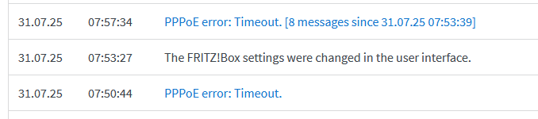{ loading=lazy }
/// caption
The FRITZ!Box logs show a PPPoE timeout.
///

Uhm. Strange.

Looking more closely at the admin panel, I can confirm that the ADSL "training"
has completed fine, and no error is reported.

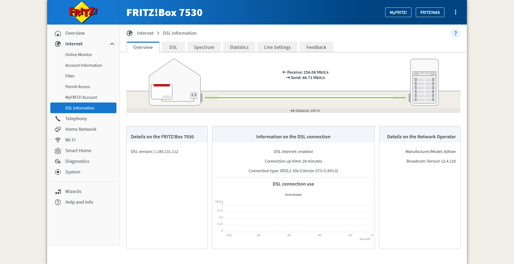{ loading=lazy }
/// caption
The ADSL status page shows that the connection was established successfully.
///

So this doesn't seem to be an issue with the cable.

I double-check all the configurations, the credentials, the physical
connections... nothing. Finally, I decide to leave the router alone for some
time. "Perhaps it's just some network configuration that has not yet propagated
fully", I lie to myself. But I can already feel that this is getting ugly.

After a few days, I try to hard-reset the ADSL router and repeat the whole
process once more. But alas, the PPPoE device on the other side of the
connection still shows no signs of life.

I then decide to reach out to technical support via email. I detail my issues,
attaching screenshots of the current configuration, the ADSL status, and the
error I am facing.

Soon, another technician appointment is scheduled.

But when the technician arrives, they know nothing about the PPPoE
configuration. The only thing they can do is to check the quality of the ADSL
connection with a handheld device. This is not at all different from the one the
first technician used when they set up the line. So, I'm hardly surprised
when my ADSL line turns out to be fine.

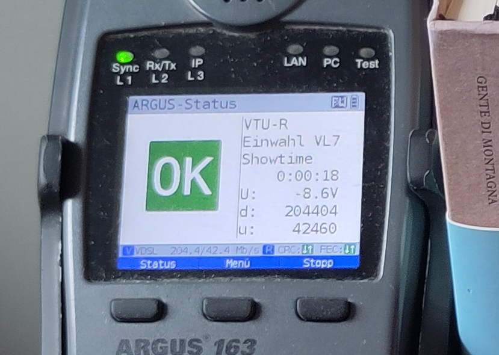{ loading=lazy }
/// caption
An Argus 163 ADSL testing device shows that the ADSL works fine. Notice how the
German word for "stop" is spelled with two "p"s.
///

I forward a photo of the test results to the Maingau technical support. Surely,
now that the ADSL functionality has been confirmed, they will be looking at the
PPPoE issue on their syst..

{ loading=lazy }
/// caption
An email from Maingau technical support declares the issue resolved.
///

or, as GMail automatic translation puts it

!!! quote ""

    Dear Ladies and Gentlemen,

    Your fault with the number "MAING-XXXXXXXXXXXXXX" has been set to the
    status "Resolved" and is therefore closed.

I try multiple times to contact customer support via phone or email to convince
them that no, the issue is not resolved, and that yes, I've already tried
rebooting the ADSL router. Nobody takes my problem to heart.

Exasperated, I decide it's time I try to do something on my own.

## Warm up

The router gives little information for any investigation. But the
nice thing about my FRITZ!Box 7530 router is that it has ✨OpenWrt support✨.

!!! tip "Remark"

    Malignant minds might think that I have been dying for an excuse to rip out
    the stock firmware from my router and install OpenWrt. They are not
    completely wrong.

I head to [the OpenWrt wiki page dedicated to my
router](https://openwrt.org/toh/avm/avm_fritz_box_7530), follow the flashing
procedure, and soon the router welcomes me over SSH. I then start combining
the DSL parameters provided by my ISP with the many examples
[in the OpenWrt wiki](https://openwrt.org/docs/guide-user/network/wan/isp-configurations).
After a little bit of trial and error, I conjure up the following configuration:

```
config atm-bridge 'atm'
    option vpi '1' # Specified by the ISP
    option vci '32' # Specified by the ISP
    option encaps 'llc'
    option payload 'bridged'
    option nameprefix 'dsl'

config dsl 'dsl'
    option annex 'j'
    option tone 'b'
    option ds_snr_offset '0'

config device
    option name 'dsl0'

config device
    option type '8021q'
    option ifname 'dsl0'
    option vid '7' # VLAN ID 7, as specified by the ISP
    option name 'dsl0.7'

config interface 'wan'
    option device 'dsl0.7'
    option proto 'pppoe'
    option username '$ISP_PROVIDED_USERNAME'
    option password '$ISP_PROVIDED_PASSWORD'
```

and that... worked! No PPPoE timeout! An IP address is negotiated and I can
finally connect to the internet! Hell, I even got an IPv6 address.

So all is good.

End of the story, right?

Right??

## Bitter taste

I start surfing, but something is off. Sometimes, websites fail to load. In most
cases, the issues are intermittent, almost forgivable. But in other cases the
issues reproduce consistently.

Here are a few examples:

- On a Debian box, `docker login ghcr.io` _always_ fails with "TLS handshake
  timeout":

    ```
    $ echo test | docker login ghcr.io -u USERNAME --password-stdin
    Error response from daemon: Get "https://ghcr.io/v2/": net/http: TLS handshake timeout
    ```

- On all Windows devices, `winget update --all` fails

    ```
    PS C:\> winget update --all
    Errore durante la ricerca nell'origine: 'msstore'
    Si è verificato un errore imprevisto durante l'esecuzione del comando:
    WinHttpSendRequest: 12002: Timeout dell'operazione

    0x80072ee2 : unknown error
    ```

!!! question "Side question"

    Honestly, how do you force PowerShell to show error messages in English? On
    Linux, I would `export LC_ALL=C`. On Windows, is the only option really to
    change the system language and reboot the machine?

- The `steamcommunity.org` website doesn't load,

    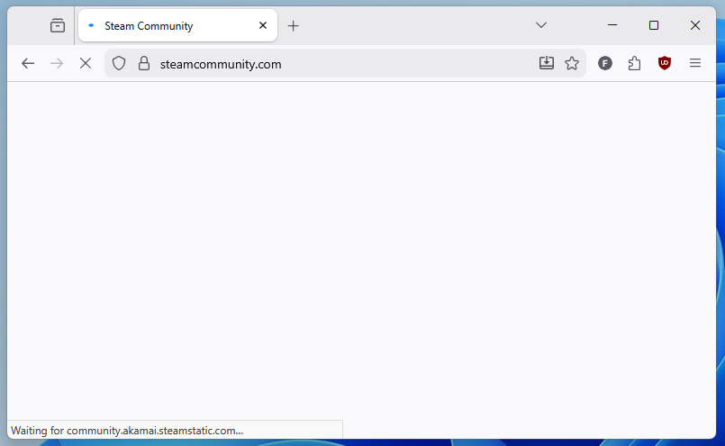{ loading=lazy }
    /// caption
    The steamcommunity.org website fails to load.
    ///

I decide to investigate the `steamcommunity.org` failure first, since:

1.  The issue can be reproduced from a browser, which has very many useful tools
    to inspect network requests,
2.  I really want to replay
    [Patrician III](https://store.steampowered.com/app/33570/Patrician_III/).

I open Firefox, start the developer tools, switch to the "Network" tab, and
ensure the "Disable Cache" option is toggled. I reload the page and find that
there is a specific asset that fails to be transferred, resulting in the website
styling not loading.

One of the key features of the Network tab is that, for every network request,
it can produce an equivalent `curl` command. In this way, the request can be
reproduced exactly from a terminal prompt. I do exactly that by right-clicking
on the request and hitting "Copy" > "Copy as cURL (Windows)".

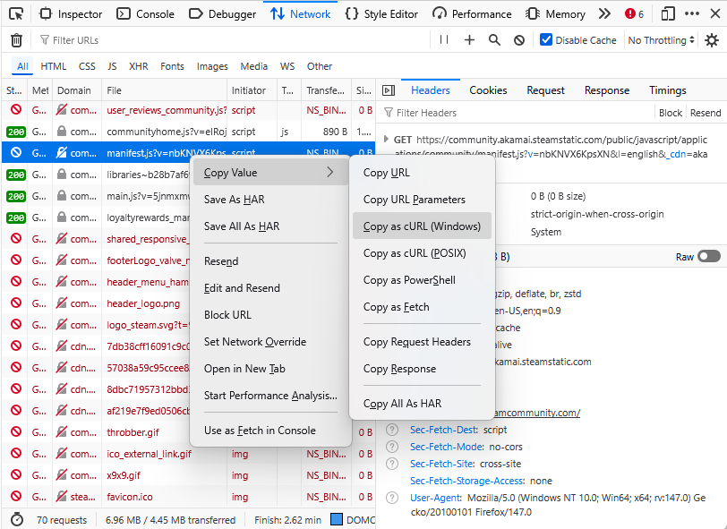{ loading=lazy }
/// caption
To whoever came up with this feature: I owe you a beer.
///

This gives me a big and noisy `curl` command that I paste into a `cmd` prompt
and run

```
C:\>curl.exe ^"https://community.akamai.steamstatic.com/public/javascript/applications/community/manifest.js?v=nbKNVX6KpsXN^&l=english^&_cdn=akamai^" ^
   -H ^"User-Agent: Mozilla/5.0 (Windows NT 10.0; Win64; x64; rv:147.0) Gecko/20100101 Firefox/147.0^" ^
   -H ^"Accept: */*^" ^
   -H ^"Accept-Language: en-US,en;q=0.9^" ^
   -H ^"Accept-Encoding: gzip, deflate, br, zstd^" ^
   -H ^"Sec-Fetch-Storage-Access: none^" ^
   -H ^"Connection: keep-alive^" ^
   -H ^"Referer: https://steamcommunity.com/^" ^
   -H ^"Sec-Fetch-Dest: script^" ^
   -H ^"Sec-Fetch-Mode: no-cors^" ^
   -H ^"Sec-Fetch-Site: cross-site^" ^
   -H ^"Priority: u=2^" ^
   -H ^"Pragma: no-cache^" ^
   -H ^"Cache-Control: no-cache^" ^
   -O NUL

curl: (52) Empty reply from server
```

All right, the error can be reproduced. Let's now try to minimize the command.
Surely, not all of these headers are _really_ needed. So I start by removing the
last `-H ...` command line option, and get...

```
C:\>curl.exe ^"https://community.akamai.steamstatic.com/public/javascript/applications/community/manifest.js?v=nbKNVX6KpsXN^&l=english^&_cdn=akamai^" ^
     -H ^"User-Agent: Mozilla/5.0 (Windows NT 10.0; Win64; x64; rv:147.0) Gecko/20100101 Firefox/147.0^" ^
     -H ^"Accept: */*^" ^
     -H ^"Accept-Language: en-US,en;q=0.9^" ^
     -H ^"Accept-Encoding: gzip, deflate, br, zstd^" ^
     -H ^"Sec-Fetch-Storage-Access: none^" ^
     -H ^"Connection: keep-alive^" ^
     -H ^"Referer: https://steamcommunity.com/^" ^
     -H ^"Sec-Fetch-Dest: script^" ^
     -H ^"Sec-Fetch-Mode: no-cors^" ^
     -H ^"Sec-Fetch-Site: cross-site^" ^
     -H ^"Priority: u=2^" ^
     -H ^"Pragma: no-cache^" ^
     -o NUL

  % Total    % Received % Xferd  Average Speed   Time    Time     Time  Current
                                 Dload  Upload   Total   Spent    Left  Speed
100  9061  100  9061    0     0  91644      0 --:--:-- --:--:-- --:--:-- 94385
```

a successful response.

Wait, what?!

## I notice that I am confused

Ok, time to think:

- Rationalization attempt #1: Perhaps the second request got answered by a
  different remote host? For good measure, I hardcode the IP of the host in the
  Windows HOSTS file and retry. But even after that, the results are the same.
  Also, replaying the request any number of times does not change the outcomes.

- Rationalization attempt #2: Maybe the issue is exactly the header I decided to
  remove? But no, even when removing some of the other headers instead, the
  request succeeds.

I'm a bit clueless by now. Time to take a shot in the dark.

What if instead of removing an HTTP header, I add one? Well, this might create
more troubles: the website's load balancer might strip my request of any HTTP
header it does not expect, or even reject the request completely... or not. I'll
try using a header name with the conventional `X-` name prefix to increase the
chances of my request not being rejected. Also, I'll use a Bash script run from
WSL from now on, because I'm more familiar with the syntax.

```bash
# test.sh
#!/bin/bash

# run_curl: Sends the same HTTP request that fails in the
#           browser, but also adding any extra HTTP header
#           that is passed in as argument.
function run_curl() {
    timeout 3 curl -s -o /dev/null \
        -H 'User-Agent: Mozilla/5.0 (Windows NT 10.0; Win64; x64; rv:142.0) Gecko/20100101 Firefox/142.0' \
        -H 'Accept: */*' \
        -H 'Accept-Language: en-US,en;q=0.5' \
        -H 'Accept-Encoding: gzip, deflate, br, zstd' \
        -H 'Connection: keep-alive' \
        -H 'Referer: https://steamcommunity.com/' \
        -H 'Sec-Fetch-Dest: script' \
        -H 'Sec-Fetch-Mode: no-cors' \
        -H 'Sec-Fetch-Site: cross-site' \
        "$@" \
        'https://community.akamai.steamstatic.com/public/javascript/applications/community/manifest.js?v=PU33sk4crNva&l=english&_cdn=akamai'
}

# Repeat the HTTP request with an extra, dummy header
# of increasing length. The header has the form:
#
#   X-1...1: a
#
# with the number of '1' characters varying from 3 to 20
for LENGTH in {3..20}; do
    # Build the header name and value
    HEADER_NAME="X-$(printf '%0*d' $((LENGTH-2)) 1 | tr '0' '1')"

    printf "Header \"%s\" (Length %2d): " "$HEADER_NAME" "$LENGTH"

    run_curl -H "$HEADER_NAME: a"

    RESULT=$?  # Get the exit code of the last command
    if [ $RESULT -eq 0 ]; then
        echo " success"
    elif [ $RESULT -eq 124 ]; then
        echo " TIMEOUT"
    else
        echo " FAILED"
    fi
done
```

```txt
$ test.sh
Header "X-1" (Length 3): TIMEOUT
Header "X-11" (Length 4): TIMEOUT
Header "X-111" (Length 5): success
Header "X-1111" (Length 6): success
Header "X-11111" (Length 7): TIMEOUT
Header "X-111111" (Length 8): success
Header "X-1111111" (Length 9): TIMEOUT
Header "X-11111111" (Length 10): TIMEOUT
Header "X-111111111" (Length 11): success
Header "X-1111111111" (Length 12): success
Header "X-11111111111" (Length 13): success
Header "X-111111111111" (Length 14): success
Header "X-1111111111111" (Length 15): success
Header "X-11111111111111" (Length 16): success
Header "X-111111111111111" (Length 17): success
Header "X-1111111111111111" (Length 18): success
Header "X-11111111111111111" (Length 19): success
Header "X-111111111111111111" (Length 20): success
```

The results show that when the header has a length of 3, 4, 7, 9, or 10
characters the request fails with a timeout. In all other cases, the request
succeeds.

To make sure the header value does not affect the outcome, I run another test
with a bunch of random values, but fixed length. In all cases, the timeout still
occurs.

```
X-ABCDEFGH:  TIMEOUT
Y-12345678:  TIMEOUT
Custom1234:  TIMEOUT
Headerasdf:  TIMEOUT
X-TEST1234:  TIMEOUT
MyHeader34:  TIMEOUT
```

Conclusion: the content of the header does not matter. It's the _length_ of the
header that does.

To determine which are the request lengths that trigger the issue, I extend the
script to repeat the request over and over for a wider range of values. Also, to
reduce the chance of flukes, I repeat each test 5 times. I then plot a graph
showing the percentage of failures for a given header size.

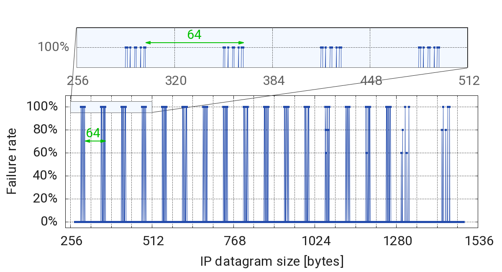{ loading=lazy }
/// caption
Percentage of request failure as a function of the IP datagram size.
///

Is that... a pattern?

## Destructured packets

So far I have managed to investigate more about the conditions in which the
request timeout is observed. However I still don't know _why_ the timeouts
occur. It's time to look more closely at the network traffic.

In order to capture the network traffic of the router, I need to install
`tcpdump` on the router. Thanks to OpenWrt, this is as simple as running

```sh
opkg update
opkg install tcpdump
```

I then fire up Wireshark on my laptop and configure it to connect via SSH to the
router following
[this guide](https://jmwoccassionalnotes.blog/2025/03/04/wireshark-remote-capture-over-ssh/).

I proceed to capture the network traffic on my router while running the `curl`
command from my laptop. To have a sense of what the traffic should normally look
like, I also capture the traffic obtained for the same `curl` command while
connected to a mobile hotspot (whose internet connection works fine).

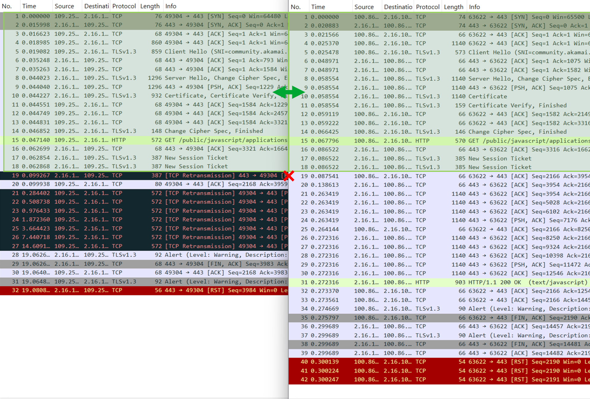{ loading=lazy }
/// caption
The network traffic captured when connecting through the ADSL router (left side,
public IP `109.25.X.X`) and through the mobile hotspot (right side, public IP
`100.86.X.X`). In both captures, the same resource is retrieved from the remote
server with IP `2.16.X.X`.
///

By comparing the two captures, it seems that the network traffic looks exactly
the same up until packet No. 18. Starting from packet No. 19 on, the packet
sequence starts to diverge:

- **Right side**: When connected to the mobile hotspot, Packet No. 19 is an
  acknowledgment (`ACK`) packet that my laptop (Source IP `100.86.X.X`) sends to
  the remote server. The packet indicates that the laptop confirms the correct
  reception of all TCP segments transmitted by the remote server up to and
  including packet No. 18. To stress this, Wireshark helpfully shows a small
  "✔️" symbol next to packet No. 18 when packet No. 19 is selected
  ([docs](https://www.wireshark.org/docs/wsug_html_chunked/ChUsePacketListPaneSection.html#id1420)).

    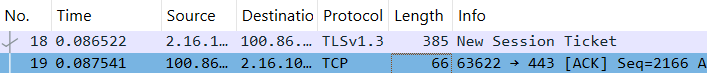{ loading=lazy }

    After this, the remote server (IP `2.16.X.X`) sends Packet No. 20,
    acknowledging the HTTP request in Packet No. 15.

    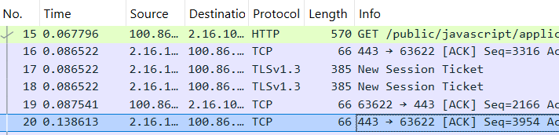{ loading=lazy }

    Then, it proceeds to send the HTTP response.

- **Left side**: When connected to the ADSL router, packet No. 19 is a TCP
  Retransmission packet that the remote host (Source IP `2.16.X.X`) sends to my
  laptop to request an explicit acknowledgment of the data received this far.
  The packet has the TCP Push (`PSH`) flag set, requesting that my laptop answer
  immediately rather than buffering its response.

    My laptop honors the request immediately with packet No. 20, which
    acknowledges all the data transmitted by the remote server up to and
    including packet No. 18.

    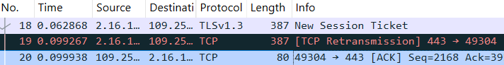{ loading=lazy }

    Somehow, the remote server does not answer after that. I guess it's waiting
    for my laptop to do something. After a few milliseconds of stalling, my
    laptop realizes that something is off, and decides to send packet No. 21,
    which re-sends the oldest packet that the remote server has not yet
    acknowledged, packet No. 15. This can also be confirmed by looking at
    the packet size, which is 572 for both packets No. 15 and 21.

    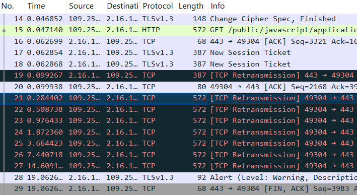{ loading=lazy }

    But nothing gets back.

    In an incredible display of perseverance, my laptop keeps retransmitting the
    same packet over and over (packets No. 22 through 27), over the course of 14
    seconds of pure suspense.

    Eventually, the remote server gives up and closes the TCP transaction by
    sending packet No. 29 with a `FIN` flag. Enigmatically, the last packets
    from the remote server do not specify if any of the retransmitted packets
    was received.

But why is this happening? I see two possible explanations:

- either Packet 19 is dropped on its way to the remote server, or
- the corresponding response packets from the remote server are dropped before
  they reach my laptop.

To rule out any of the two, we'd need to get the packet capture on the remote
side as well. However, I find it unlikely that the Steam DevOps team is willing
to provide that to me.

What else can be done then?

## Homemade cloud

Here's the idea: spin up a small Virtual Machine (VM) on the cloud, connect to
it via my ADSL, and try to mimic the packet exchange of the Steam server.

To imitate the HTTP server, I invoke the `http.server` module from the Python
standard library to serve an empty directory via HTTP

```bash
mkdir empty
cd empty
python3 -m http.server 80 --bind "0.0.0.0"
```

I send an HTTP request with `curl`, but this time targeting the public IP of my
server. It still fails! This means I can now reproduce the issue and inspect the
packets observed at both sides of the network.

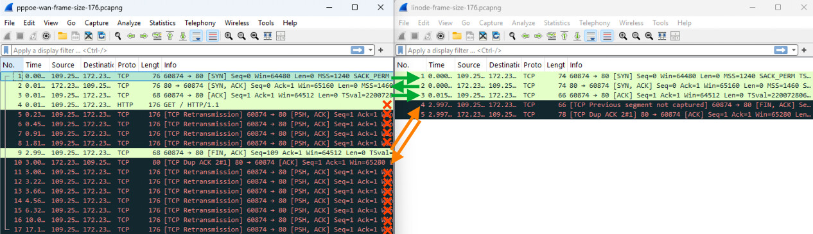{ loading=lazy }
/// caption
The TCP packets captured on my ADSL router (left side, IP `109.250.XX.XX`) and
on the remote VM (right side, IP `172.238.XX.XX`).
///

I have added arrows to link together matching packets on the right and left
sides. The direction of the arrow indicates the traveling direction of the
packet.

Here is my reconstruction of the exchange, following the packet numbering of the
left pane:

- ✅ Packets No. 1 to 3 are exchanged correctly.
- ❌ Packet No. 4 only appears in the left pane (indeed, there is no packet with
  protocol "HTTP" in the right pane), indicating that it never reached its
  destination. Perhaps, this is due to its length (176 bytes) being "cursed"?
- ❌ Packets No. 5 to 8 are all attempts at retransmitting packet No. 4. In all
  cases, the retransmission does not reach its destination. It might not be a
  coincidence, because they also have the cursed length.
- ⚠️ `curl` reaches the 3-second timeout specified in the script and closes the
  connection with packet No. 9, which has the `FIN` flag set. The packet is
  received correctly by the remote VM! This is also visible in the right pane
  (perhaps because it does not have the cursed length). The packet has the
  Sequence number 109, which the VM did not expect. Wireshark kindly highlights
  that in the right pane by showing the label `Previous segment not captured` in
  the "Info" column.
- ⚠️ Since the Sequence number is off, the remote VM sends back Packet No. 9.,
  signaling that it can not acknowledge the `FIN` request, since something in
  the middle definitely went missing.
- ❌ The client then tries to re-send the packet multiple times. Alas, all
  subsequent TCP retransmissions also fail, having the cursed length.

This test confirms that the issue affects outgoing packets traveling from my
network to the outside Internet. Additionally, it seems that
the packet size is significant in determining the outcome, but what about the
packet protocol?

## Down the rabbit hole

So far all tests were based on HTTP requests sent over TCP packets. I decide to
try a similar test using `ping`, which uses the ICMP protocol instead. ICMP
packets also have a payload, and the payload length can be configured with the
`-s` option of `ping`.

So why not compare the failure rate of `ping` and that of `curl` for the same
datagram size?

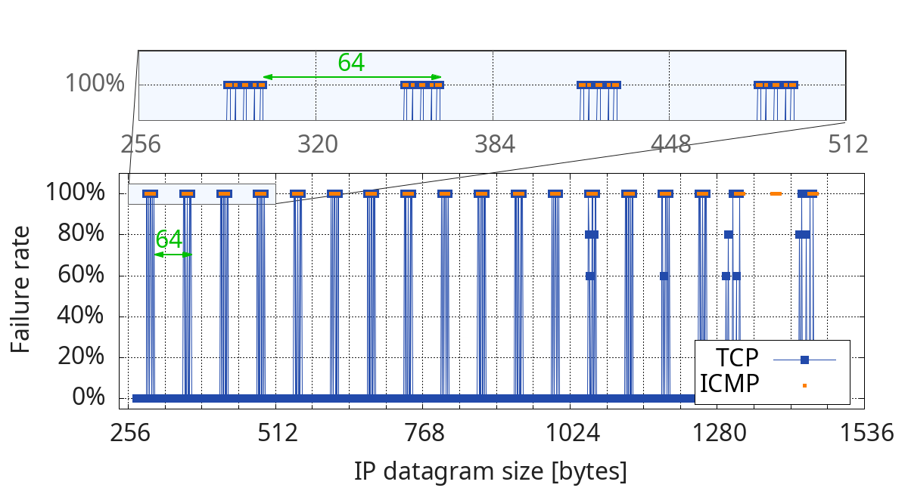{ loading=lazy }
/// caption
Percentage of request failure as a function of the IP datagram size for both TCP
and ICMP protocols.
///

Quoting [Al Gore's sixth grade classmate](https://www.youtube.com/watch?v=-JIuKjaY3r4&t=203s),

!!! quote ""

    _Did they ever fit together?_

The data suggests that both the TCP and ICMP requests are affected in the same
way, as long as the overall datagram length is the same. If that is true, then
the root cause might lie below Layer 3 of the ISO model.

But honestly, what can I do about this?

!!! quote ""

    _To be continued_

??? info "This post is part of a series"

    > 1. (this post)
    > 2. [How to fix a soft-bricked FritzBox 7530 after installing OpenWrt](./how-to-fix-soft-bricked-fritzbox-7530-after-openwrt-install.md)
    > 3. [Datagrams must be this tall to ride (Part 2)](./datagrams-must-be-this-tall-to-ride-part-2.md)

## Acknowledgements

The cover picture comes from
[this YouTube video](https://youtu.be/lL8ELL9p5ms?t=31).
Furthermore, I would like to thank the folks in the OpenWrt forum for their
very good troubleshooting suggestions and for
[listening to my crazy ravings](https://forum.openwrt.org/t/tls-ssl-connection-timeouts-with-fritz-box-7530-as-adsl-router/240651).
