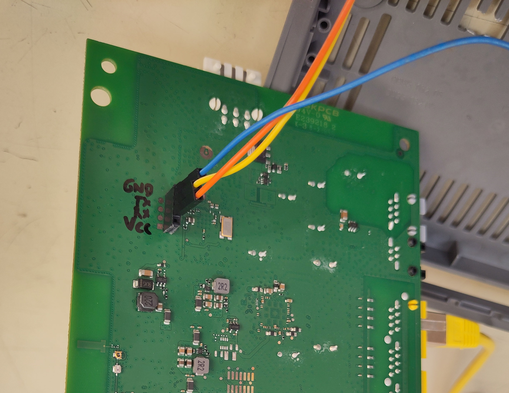
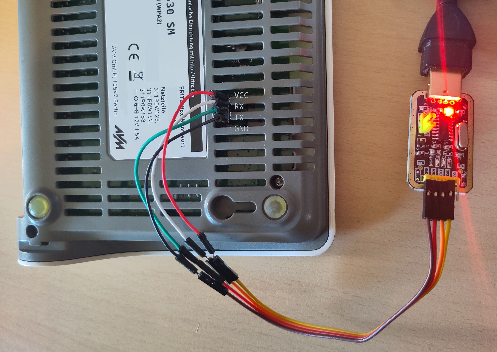

_This is a filler episode in the post series about tall datagrams._

??? info "Other posts in the series"

    > 1. [Datagrams must be this tall to ride (Part 1)](./datagrams-must-be-this-tall-to-ride-part-1.md)
    > 2. (this post)

Everybody knows, troubleshooting a misbehaving ISP connection would not be fun
enough if the router didn't soft-brick halfway through the investigation
process.

Oh well.

<div style="position:relative; padding-bottom:56.25%; height:0; overflow:hidden;">
  <iframe src="https://www.youtube.com/embed/AbSehcT19u0"
    style="position:absolute; top:0; left:0; width:100%; height:100%;"
    title="YouTube video player" frameborder="0" allowfullscreen></iframe>
</div>

## Triage

Here is how the issue presents itself:

1. I flashed an OpenWrt image on my FritzBox 7530 router using `sysupgrade`

2. On the next reboot, the "Power/DSL" LED flashes a few times, then stays
   constantly lit up, but the router doesn't actually come online. No SSH
   connectivity can be obtained.

If you have a USB-to-TTL adapter, you can follow the steps mentioned next to
make sure that you're facing the same issue I am getting. Otherwise,
if you feel lucky, you can just skip to the next section.

!!! info "Note"

    If you don't have a USB-to-TTL adapter, you can probably borrow one from
    your local hackerspace. If you really want to buy one, the ["AZDelivery USB
    TTL Adapter 3.3 V or 5 V with
    CH340G"](https://www.amazon.de/-/en/dp/B08T24NML9) is the one I used
    (disclaimer: not an affiliated link).

For setting up the serial connection to the router, I recommend reading [the
dedicated page on the OpenWrt
wiki](https://openwrt.org/docs/techref/hardware/port.serial#communicate_with_router).
It contains a lot of useful guidance for newcomers.

!!! warning "Warning"

    There is 1 thing that the wiki got wrong for my adapter. The wiki
    recommends NOT connecting the VCC pin of the USB-to-TTL adapter. But for my
    adapter, connecting it was required to make it work.

Additionally, [the OpenWrt wiki page for the FritzBox
7530](https://openwrt.org/toh/avm/avm_fritz_box_7530#serial) contains
information on the serial port header location and baud rate. Based on that, I
soldered some female headers for ease of use.

{ loading=lazy }
/// caption
The serial connection headers.
///

I punched a hole in the plastic case so that the USB-to-TTL adapter can be
connected without removing the case.

{ loading=lazy }
/// caption
Connecting the FritzBox 7530 to the USB-to-TTL adapter.
///

!!! warning "Warning for Windows Users"

    Some USB-to-TTL adapters use a counterfeit PL2303 chip. As a result, they
    might not work out of the box on Windows because the company making the
    original chips, Prolific, released a Windows driver that refuses to work
    with counterfeit chips. Here is [a working fix for the
    driver](https://www.ifamilysoftware.com/Prolific_PL-2303_Code_10_Fix.html),
    which requires .NET Framework 3.5. If you find issues installing .NET
    Framework 3.5, consider also following [these
    steps](https://www.winhelponline.com/blog/net-framework-3-5-error-0x800f0950-windows-10-dism/).

After you've wired the router to the serial, open a connection with your
favorite serial port interface. For example, using GNU Screen

```
$ screen /dev/ttyUSB0 115200
```

Once you've established a good serial connection with no garbled text, power
cycle the router and look at the console output. If the following lines are
shown, then you're facing the same issue I did:

```hl_lines="1 2 3 4 5"
UBI warning: print_rsvd_warning: cannot reserve enough PEBs for bad PEB handling, reserved 1, need 8
UBI error: ubi_wl_init_scan: no enough physical eraseblocks (0, need 1)
UBI error: ubi_init: cannot attach mtd1
UBI error: ubi_init: UBI error: cannot initialize UBI, error -12
UBI init error 12
eth0 PHY0 Down Speed :10 Half duplex
eth0 PHY1 Down Speed :10 Half duplex
eth0 PHY2 Down Speed :10 Half duplex
eth0 PHY3 Down Speed :10 Half duplex
eth0 PHY4 Down Speed :10 Half duplex
...
```

## Cause

The cause and solutions were identified by [@mjw99](https://github.com/mjw99) in
[this GitHub issue](https://github.com/chunkeey/FritzBox-4040-UBOOT/issues/9).
Thanks, mjw99!

The issue seems to be that the NAND storage chip used for storage has too high a
number of "bad" PEB blocks, and refuses to boot.

## Solution

The fix is to shrink the data volume, freeing some PEB blocks on the NAND
storage. In this way, the free PEB blocks can be used to replace the "bad" ones.

Here are the instructions on how to achieve this:

1.  First, gather:
    - the initramfs image of the OpenWrt version you wish to install
      ([example](https://downloads.openwrt.org/releases/25.12.6/targets/ipq40xx/generic/openwrt-25.12.6-ipq40xx-generic-avm_fritzbox-7530-initramfs-uImage.itb)),
    - the sysupgrade image of the OpenWrt version you wish to install
      ([example](https://downloads.openwrt.org/releases/25.12.6/targets/ipq40xx/generic/openwrt-25.12.6-ipq40xx-generic-avm_fritzbox-7530-squashfs-sysupgrade.bin)),
    - a backup of your OpenWrt config.

2.  Boot the initramfs image of OpenWRT. Since this is loaded from RAM, it will
    run regardless of the PEB block state. You can do this by following steps 1
    through 3 of the flashing instructions on [the FritzBox 7530 wiki
    page](https://openwrt.org/toh/avm/avm_fritz_box_7530#installation). Getting
    the device to boot from TFTP might require several attempts to get the
    timing right.

    !!! tip "Tip"

        If you have already flashed U-Boot and have the serial console already
        set up, there is a way to get the timing right 100% of the time.

        1.  Set up the TFTP server to serve the initramfs image as per the
            official steps.

        2.  Power-cycle the router with the serial console connected. When the
            console shows the message `Hit any key to stop autoboot`, then hit
            any key. This will get you the U-Boot interactive prompt.

        3.  Type the following commands to boot the initramfs image named
            `FRITZ7530.bin` served from the TFTP server at 192.168.1.70

            ```
            setenv ipaddr 192.168.1.1
            setenv serverip 192.168.1.70
            setenv netmask 255.255.255.0
            ping 192.168.1.70
            tftpboot 0x85000000 FRITZ7530.bin
            bootm 0x85000000
            ```

3.  Open a prompt into the intramfs image you just booted, either with the
    serial console or SSH.

    !!! info "Info"

          If you had already SSH-ed into the system before booting the initramfs
          image, you might get the following error

          ```hl_lines="11"
          @@@@@@@@@@@@@@@@@@@@@@@@@@@@@@@@@@@@@@@@@@@@@@@@@@@@@@@@@@@
          @    WARNING: REMOTE HOST IDENTIFICATION HAS CHANGED!     @
          @@@@@@@@@@@@@@@@@@@@@@@@@@@@@@@@@@@@@@@@@@@@@@@@@@@@@@@@@@@
          IT IS POSSIBLE THAT SOMEONE IS DOING SOMETHING NASTY!
          Someone could be eavesdropping on you right now (man-in-the-middle attack)!
          It is also possible that a host key has just been changed.
          The fingerprint for the ED25519 key sent by the remote host is
          SHA256:yK/IxrI/BERvxC8KdyIX8m1Tz6dyhAtz1X9k386tPqg.
          Please contact your system administrator.
          Add correct host key in /home/user/.ssh/known_hosts to get rid of this message.
          Offending ED25519 key in /home/user/.ssh/known_hosts:57
          Host key for 192.168.1.1 has changed and you have requested strict checking.
          Host key verification failed.
          ```

          This is likely because the system booted from the initramfs image is
          using a SSH key generated on-the-fly. Your SSH client is baffled
          because it expected the SSH key of the original system.

          To fix the issue, open the `~/.ssh/known_hosts` file and delete the
          line mentioned in the error message (in this example, line 57).

4.  Transfer the sysupgrade image to the router with `scp`

    ```
    $ scp -O /path/to/local/my_sysupgrade.bin root@192.168.1.1:/tmp/
    ```

    !!! info "Note"

        The `-O` arugment is required because, by default, the SSH server on
        OpenWrt does not expose an SFTP server. Therefore, `scp` must be
        configured to use the "legacy SCP protocol".

5.  Flash the sysupgrade image on the router

    ```
    # sysupgrade -n /tmp/my_sysupgrade.bin
    ```

6.  The router will now update the volumes once more, but their size will still
    be wrong. Repeat the instructions in step 2 to boot the initramfs
    image one more time.

7.  Connect once more to the initramfs system, either via the serial console or
    via SSH.

8.  Use the `ubinfo` command to verify the current volumes on UBI device `ubi0`:

    ```hl_lines="13"
    # ubinfo -d 0
    ubi0
    Volumes count:                           3
    Logical eraseblock size:                 126976 bytes, 124.0 KiB
    Total amount of logical eraseblocks:     849 (107802624 bytes, 102.8 MiB)
    Amount of available logical eraseblocks: 0 (0 bytes)
    Maximum count of volumes                 128
    Count of bad physical eraseblocks:       23
    Count of reserved physical eraseblocks:  0
    Current maximum erase counter value:     54
    Minimum input/output unit size:          2048 bytes
    Character device major/minor:            245:0
    Present volumes:                         0, 1, 2
    ```

    The last line of the command output indicates that 3 volumes are present,
    with IDs 0, 1, and 2.

9.  Now check the volume with ID 2 on the `ubi0` device. It should have a size
    of around 90MB and named `rootfs_data`.

    ```hl_lines="5 7"
    # ubinfo -d 0 -n 2
    Volume ID:   2 (on ubi0)
    Type:        dynamic
    Alignment:   1
    Size:        764 LEBs (97009664 bytes, 92.5 MiB)
    State:       OK
    Name:        rootfs_data
    Character device major/minor: 245:3
    ```

10. Resize the volume to a smaller value. Depending on how many bad PEBs you
    have, you can try a bigger or smaller value. If the value you pick is too
    high, you will face the boot error again on the next boot. If the value you
    pick is too low, you sacrifice a little bit of the storage space for
    OpenWrt.

    ```
    # ubirsvol /dev/ubi0 -N rootfs_data -s 60MiB
    ```

    Now, let's check the size again to verify that the volume was shrunk.

    ```hl_lines="5"
    # ubinfo -d 0 -n 2
    Volume ID:   2 (on ubi0)
    Type:        dynamic
    Alignment:   1
    Size:        496 LEBs (62980096 bytes, 60.0 MiB)
    State:       OK
    Name:        rootfs_data
    Character device major/minor: 245:3
    ```

    All looks fine!

11. Reboot the device.

    ```
    # reboot -f
    ```

    Now, on the serial console, instead of the PEB error, you will get a message
    along these lines

    ```
    Read 0x0 bytes from volume [kernel] offset 0x0 to 85000000
    No size specified -> Using max size (0x383000)
    UBI: scrubbed PEB 721 (LEB 0:0), data moved to PEB 467
    UBI: scrubbed PEB 725 (LEB 0:4), data moved to PEB 516
    UBI: scrubbed PEB 727 (LEB 0:6), data moved to PEB 504
    UBI: scrubbed PEB 731 (LEB 0:10), data moved to PEB 0
    UBI: scrubbed PEB 732 (LEB 0:11), data moved to PEB 498
    UBI: scrubbed PEB 735 (LEB 0:14), data moved to PEB 489
    UBI: scrubbed PEB 738 (LEB 0:17), data moved to PEB 480
    UBI: scrubbed PEB 739 (LEB 0:18), data moved to PEB 462
    UBI: scrubbed PEB 740 (LEB 0:19), data moved to PEB 458
    UBI: scrubbed PEB 743 (LEB 0:22), data moved to PEB 303
    UBI: scrubbed PEB 745 (LEB 0:24), data moved to PEB 250
    UBI: scrubbed PEB 746 (LEB 0:25), data moved to PEB 244
    ## Booting kernel from FIT Image at 85000000 ...
    ```

    and the system should boot fine.

12. Restore the OpenWrt backup from the GUI (instructions
    [here](https://openwrt.org/docs/guide-user/troubleshooting./backup_restore#restore)).

The new volume size is persisted across reboots. Unfortunately, the volume
will be resized back to its full size on every OpenWrt update. Therefore, you'll
have to repeat this process after flashing a new version.
